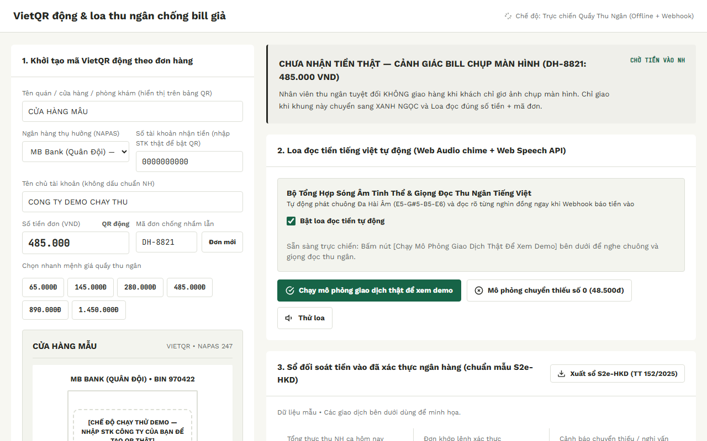
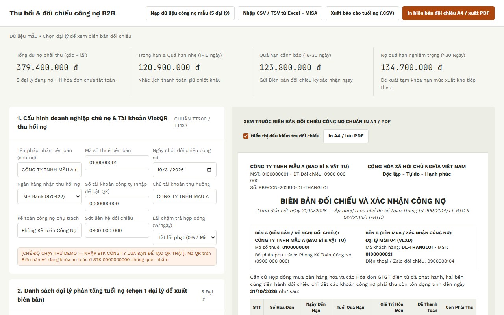
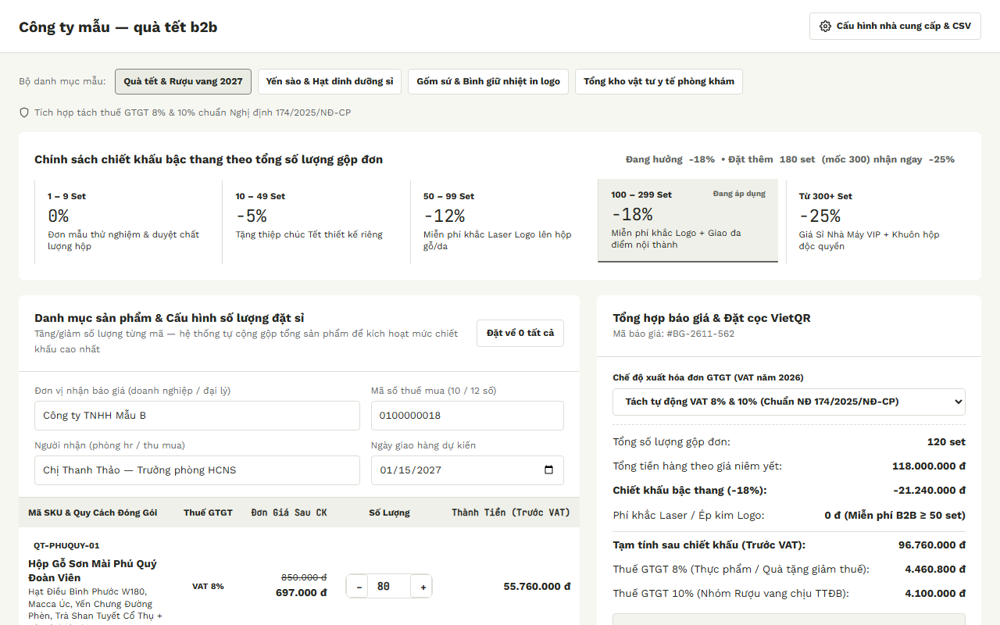
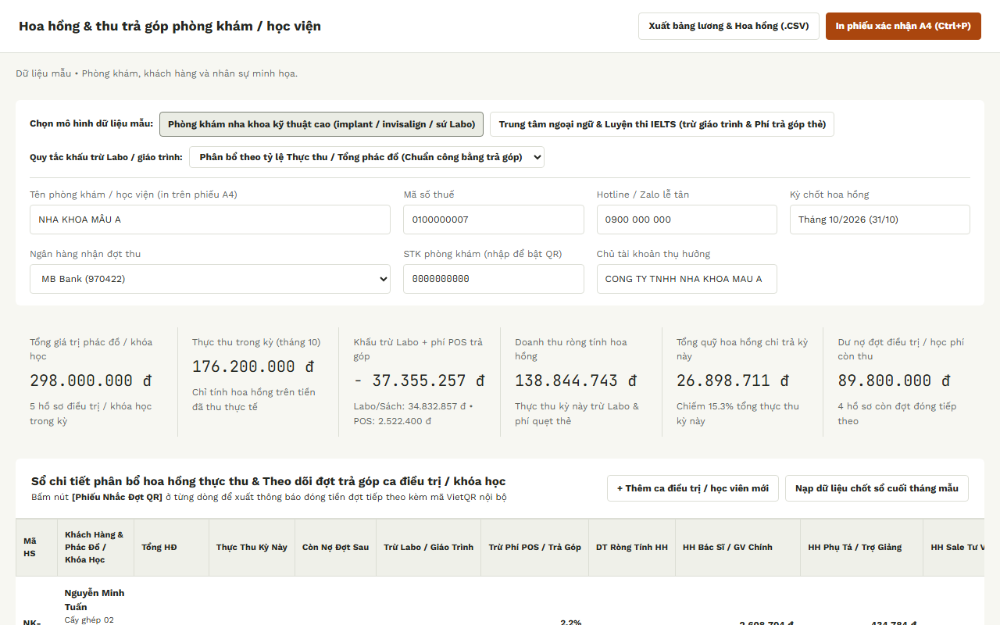
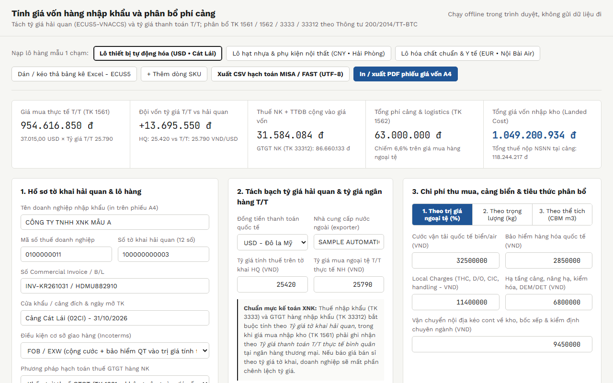
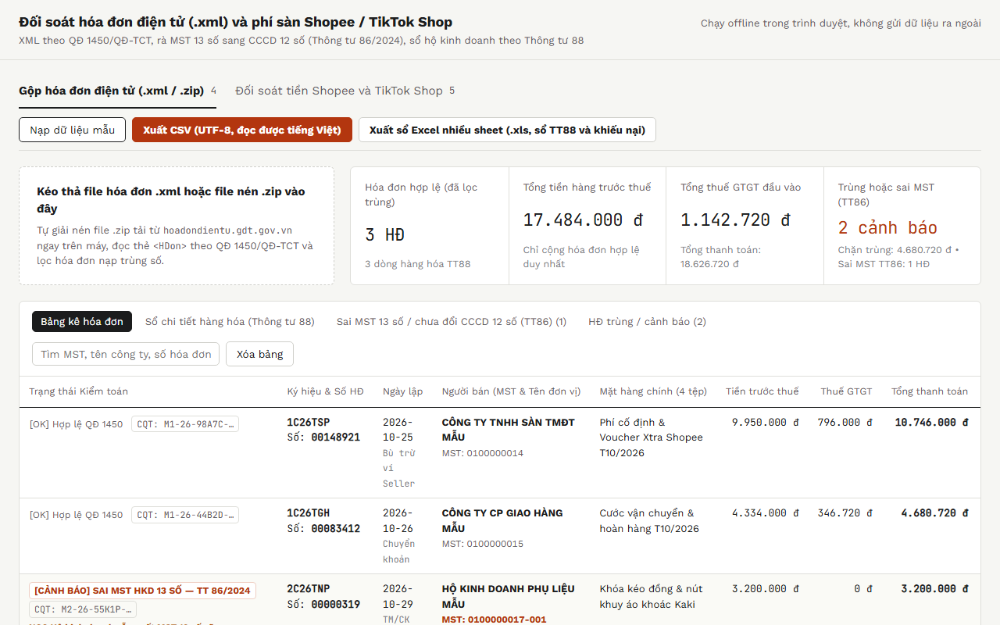
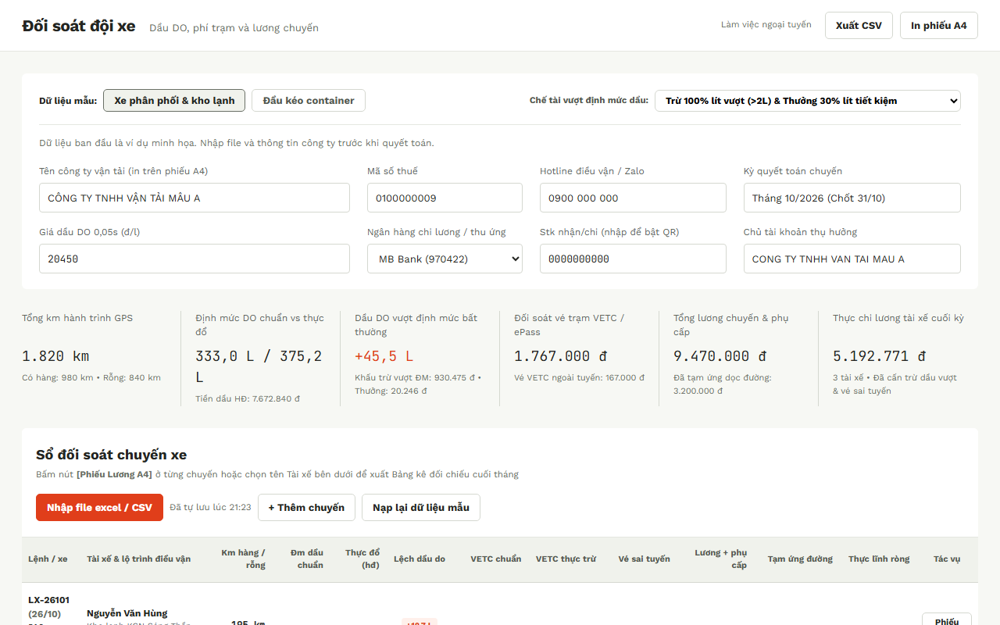
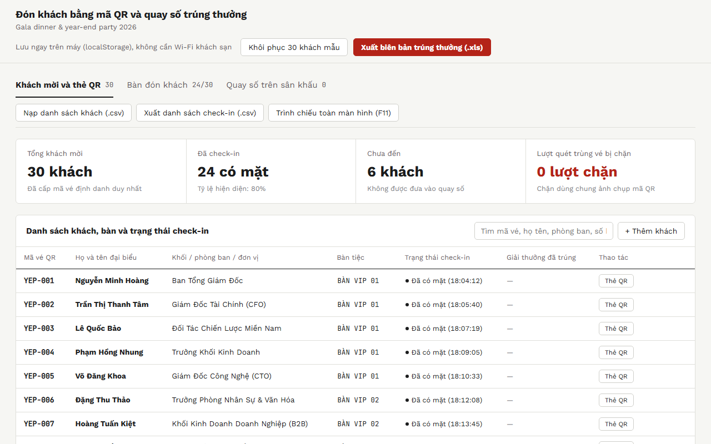

# vn-sme-offline-tools

Offline browser tools for Vietnamese small businesses: VietQR cashier, receivables aging, wholesale quotes, fleet fuel reconciliation, e-invoice XML checks and a few more.

*Bộ công cụ chạy offline trong trình duyệt cho hộ kinh doanh và doanh nghiệp nhỏ Việt Nam.*

**Status:** Built as demos/templates; adapt fields to each business.

## How it works

- Every tool is a single HTML page with vanilla JavaScript. There is no server, no build step and no account.
- Data you type or import stays on your device; nothing is uploaded unless you turn on one of the optional features below. Some tools save their state in `localStorage` (the VietQR cashier, the fleet reconciler and the year-end party check-in), so a page refresh does not lose your work.
- All names, tax IDs, phone numbers and bank accounts in the sample data are placeholders (for example `0100000001`, `0900 000 000`, account `0000000000`). The QR codes are locked to the placeholder account until you enter your own.
- Optional features that talk to the network are off by default: the VietQR cashier can call a Google Apps Script webhook if you paste its URL, the wholesale quote builder can load a price list from a published Google Sheets CSV link, and the cashier can show a QR image from the public `img.vietqr.io` API. Everything else works without a connection.

## Run it

- **Online demo:** `https://tthanh2k6.github.io/vn-sme-offline-tools/` (placeholder, Pages is not enabled yet)
- **Locally:** download or clone the repo and open `index.html` in Chrome, Edge or Firefox. Keep the folder structure: the tools load fonts from `assets/fonts/`.

```
index.html              hub page
tools/<slug>.html       one file per tool
assets/fonts/           Work Sans + JetBrains Mono (SIL OFL 1.1)
assets/screenshots/     1280x800 screenshots used by the hub and this README
```

## Tools

### 1. Dynamic VietQR cashier with payment voice alert

*VietQR động & loa thu ngân* · [`tools/vietqr-cashier.html`](tools/vietqr-cashier.html)

Builds a per-order VietQR (EMVCo payload and QR encoded in the page), reads the amount aloud when a payment is confirmed, and keeps a reconciliation ledger.



### 2. B2B receivables aging and reconciliation

*Thu hồi & đối chiếu công nợ B2B* · [`tools/ar-aging.html`](tools/ar-aging.html)

Imports CSV/TSV, buckets invoices by days overdue, prints an A4 confirmation letter with a VietQR, and drafts 3-level Zalo reminders.



### 3. Wholesale and corporate gift quote builder

*Báo giá sỉ & quà tặng doanh nghiệp* · [`tools/wholesale-quote.html`](tools/wholesale-quote.html)

Tiered volume discounts, split 8%/10% VAT, a deposit VietQR and a printable A4 quotation.



### 4. Clinic and academy commission and installment tracker

*Hoa hồng & trả góp phòng khám, học viện* · [`tools/clinic-commission.html`](tools/clinic-commission.html)

Computes staff commission net of lab and card fees, tracks installment payments, and prints A4 slips.



### 5. Import landed cost and allocation

*Giá vốn hàng nhập khẩu* · [`tools/landed-cost.html`](tools/landed-cost.html)

Allocates freight, insurance, port fees and duties to each line item to get the landed unit cost.



### 6. E-invoice XML and marketplace fee reconciler

*Đối soát hóa đơn XML & phí sàn TMĐT* · [`tools/tax-xml-reconciler.html`](tools/tax-xml-reconciler.html)

Reads e-invoice .xml/.zip files, removes duplicates, flags tax-ID format issues, and reconciles Shopee / TikTok Shop payouts.



### 7. Fleet fuel, toll and driver pay reconciler

*Đối soát đội xe* · [`tools/fleet-reconciler.html`](tools/fleet-reconciler.html)

Imports trip sheets from Excel (.xlsx) or CSV, compares fuel used against the norm, checks VETC toll charges, and computes driver pay.



### 8. Year-end party QR check-in and lucky draw

*Check-in QR & quay số year-end party* · [`tools/yep-lucky-draw.html`](tools/yep-lucky-draw.html)

Issues QR tickets, checks guests in, blocks duplicate scans, and runs the stage draw with crypto.getRandomValues.



### 9. Nail salon booking page template

*Mẫu website tiệm nail (Mỹ / Úc)* · [`tools/nail-salon-booking.html`](tools/nail-salon-booking.html)

Landing and booking page for Vietnamese-owned nail salons abroad; name, address, hours and currency come from URL parameters.


## Tech notes

- Plain HTML, CSS and JavaScript. No frameworks and no third-party scripts.
- VietQR payloads follow the EMVCo / NAPAS 247 format (with CRC16) and the QR matrix is encoded in the page, so the cashier works offline.
- The fleet reconciler reads `.xlsx` files without a library: it unzips the workbook with the browser's `DecompressionStream('deflate-raw')`, then parses `sharedStrings.xml` and the sheet XML. It also accepts CSV with comma or semicolon separators, Vietnamese column names, Excel date serials and `1.234,5` style numbers. The e-invoice reconciler uses the same approach for `.zip` archives of invoice XML.
- Exports are CSV (UTF-8 with BOM so Excel shows Vietnamese correctly) or `.xls` built from HTML tables; printable pages use `@media print` for A4.
- The year-end party draw uses `crypto.getRandomValues`.
- Fonts are shared from `assets/fonts/` instead of being embedded in each page.

## License

Code: MIT, see [LICENSE](LICENSE). Fonts: SIL Open Font License 1.1, see [assets/fonts/OFL.txt](assets/fonts/OFL.txt).
